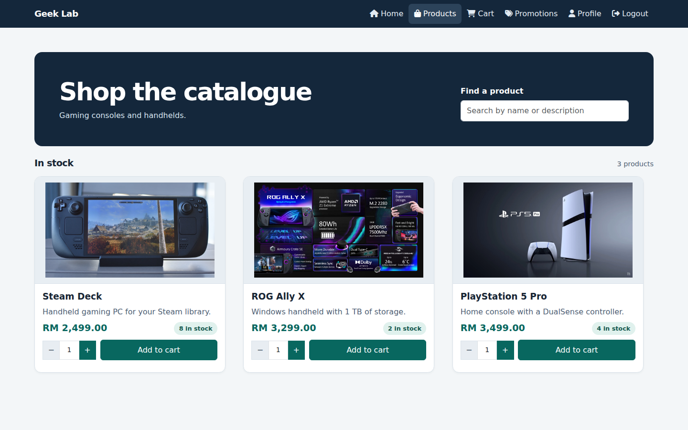
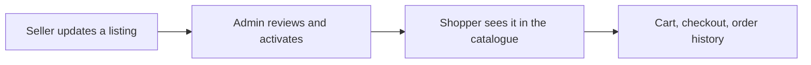
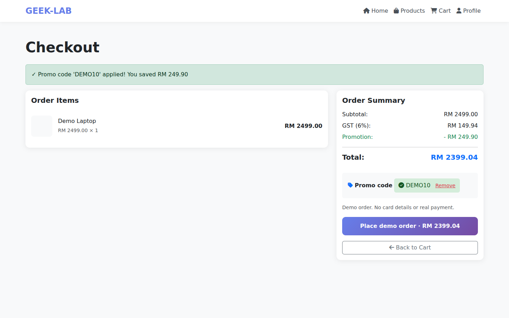

# Geek Lab · Eduvo E-Commerce

**Chin Yi Zhe · Eduvo Academy · DSE207 coursework, 2025**

I built this shop for class in 2025 and came back to it in 2026 while looking for an internship. By then I could have generated a fresh portfolio project in an afternoon. I wanted to get better at fixing the one I already had. Geek Lab is the shop name. Yeezy Labs was the inside joke.

The app built, but **Add Product** and **Checkout** both crashed. Fixing those clicks meant finding the missing pages, following the requests through the controllers, and testing them with a real database.



*Captured in Chromium from the running ASP.NET Core MVC app with a disposable SQL Server database and sample listings.*

## See the app in action

| Who | What to try |
| --- | --- |
| **Seller** | Edit the stock on the pending Demo Laptop listing and see the saved quantity. [Seller inventory](docs/screenshots/seller-products.png) |
| **Admin** | Filter to pending listings and activate the Demo Laptop so shoppers can see it. [Product management](docs/screenshots/admin-products.png) · [Phone view](docs/screenshots/admin-mobile.png) |
| **Shopper** | Find the activated listing in the catalogue. To try checkout, add one Steam Deck, apply `DEMO10`, then find the RM 2,399.04 order in order history. [Checkout](docs/screenshots/shopper-checkout.png) · [Phone view](docs/screenshots/shopper-mobile.png) · [Order history](docs/screenshots/shopper-order-history.png) |

## One listing, three roles



The walkthrough uses a Demo Laptop for the listing workflow and a Steam Deck for checkout. [Follow the actual controllers, views and pricing code](docs/PROJECT-MAP.md).

## A closer look

| Seller inventory | Admin review |
|:---:|:---:|
|  |  |
| Update a listing and its stock. | Review a listing before it goes live. |

| Checkout | On a phone |
|:---:|:---:|
|  |  |
| Follow an order through the demo checkout. | Check the layout beyond a desktop screenshot. |

## The bug that taught me the most

My favorite check was two shoppers trying to buy the last unit. In SQL Server, one order went through, the other shopper landed back in the cart, and the listing ended up with zero stock. The recovered checkout read inventory before the transaction started. Moving the read into the transaction and handling the conflict meant the second shopper got a useful response.

I also documented repairs to antiforgery handling, password storage, output encoding and product-image paths, alongside the gaps that still need work. [Defensive review and evidence](docs/VERIFICATION.md#follow-up-repairs-and-defensive-review).

The current suite passes **29 automated tests**. The MVC integration tests use EF Core’s in-memory provider and verify that a changed price, quantity, or promotion requires another review. A separate Chromium run against SQL Server confirmed that a seller’s stock edit reaches the catalogue after Admin activation and that checkout records the discounted total. [Verification notes and known limits](docs/VERIFICATION.md)

## Run it yourself

With Docker, Bash, Python 3, curl, a .NET SDK that can target .NET 8, and the .NET 8 runtime, clone the repo and run this from its root:

```bash
./scripts/start-demo.sh
```

That's the original one-command idea. It starts SQL Server and Mailpit, applies migrations, seeds the shop, and starts the app. Use the sample accounts from the launcher and keep forwarded Codespace ports private. The [demo guide](docs/DEMO.md) covers the browser walkthrough and running beside an existing demo.

To check a running demo or test your own changes:

```bash
./scripts/check-demo.sh
dotnet test Eduvo.Tests/Eduvo.Tests.csproj
```

## Code and project direction

The [project map](docs/PROJECT-MAP.md) follows a listing from Seller inventory to Admin review and Shopper checkout, with links to the Razor views, controller actions, and pricing code. It also maps where I could take the project next, including listing history and clearer feedback when price or stock changes.

This is a coursework demo. It uses an in-process session, some assets come from CDNs, and uploads are checked by size and signature. [Known limits](docs/VERIFICATION.md#remaining-work)
