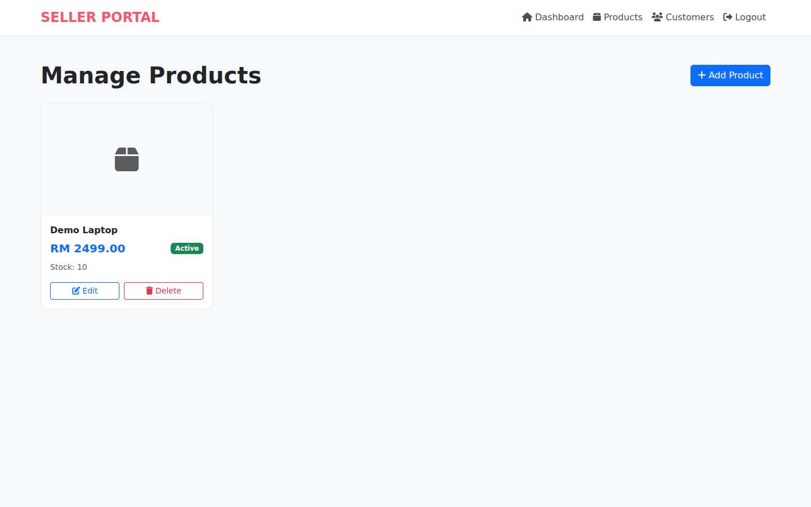
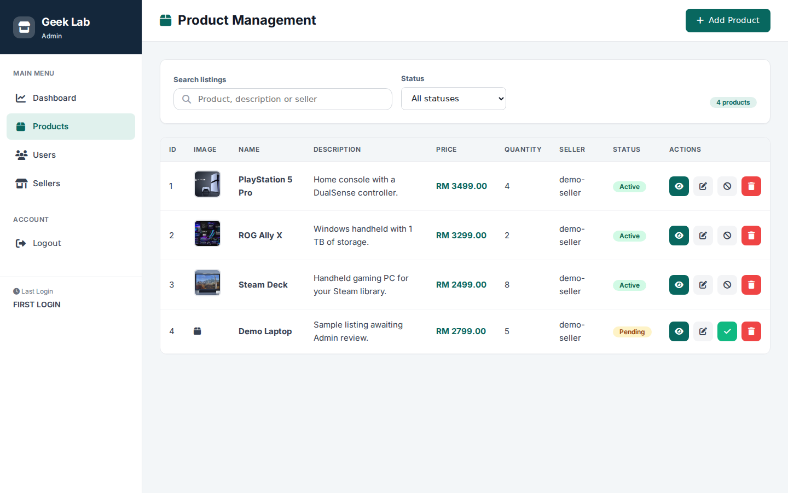
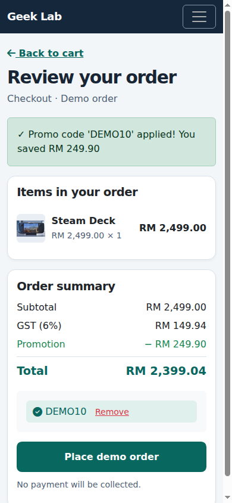

# Geek Lab | From coursework to a working shop

**Chin Yi Zhe · DSE207, Eduvo Academy · Built in 2025, revisited in 2026**

I built Geek Lab for class in 2025. When I came back to the project while looking for an internship, it compiled, but parts of the shop didn't actually work. **Add Product** and **Checkout** were two of the first clicks to fail.

I didn't want another fresh demo with no history. I wanted to understand what had broken, recover the missing pieces, and test the repairs. Geek Lab is the storefront's original name. Yeezy Labs is where I put the engineering work.

[](docs/screenshots/shopper-catalogue.png)

*Actual Chromium capture of a disposable ASP.NET Core MVC + SQL Server demo, not a design mockup.*

## The shop, in four screens

| Seller: manage inventory | Admin: review listings |
|:---:|:---:|
| [](docs/screenshots/seller-products.png) | [](docs/screenshots/admin-products.png) |
| Change stock on a pending listing. | Activate the listing before shoppers see it. |

| Shopper: checkout | Small-screen layout |
|:---:|:---:|
| [](docs/screenshots/shopper-checkout.png) | [](docs/screenshots/shopper-mobile.png) |
| Review a demo order and promotion. | See how the checkout fits a narrow viewport. |

**The listing journey:** Seller edits **Demo Laptop (Pending)** → Admin activates it (**Active**) → Shopper finds it in the catalogue. The **Steam Deck checkout** is a separate demo flow, not the same item.

[Admin phone view](docs/screenshots/admin-mobile.png) · [Recorded order history](docs/screenshots/shopper-order-history.png) · [Routes and source map](docs/PROJECT-MAP.md)

## The bug worth talking about

Two shoppers tried to purchase the last unit. In the recorded SQL Server check, one order succeeded, the other shopper returned to the cart, and stock finished at zero.

The earlier checkout loaded inventory before its transaction began. The repair reads and checks stock inside a serializable transaction, handles conflicts, and protects against duplicate order submission. This is the kind of bug a successful build cannot catch on its own.

That work sits alongside fixes for **missing Razor views**, **antiforgery headers on AJAX updates**, **password storage**, **output encoding**, and **product-image handling**. The [verification record](docs/VERIFICATION.md) distinguishes tested behavior from code review and remaining risks; it is not a claim that every route is production-ready.

## What was actually tested

**29 xUnit test cases** are present in the current test sources; the latest recorded run reported **29 passed**. The HTTP integration tests use EF Core's **in-memory provider**, not SQL Server. Separate browser sessions exercised the demo against SQL Server, including listing approval, stock edits, promotions and order history. A **two-shopper/last-unit SQL Server check** was also recorded.

The newest checkout-review changes have automated test evidence, but were **not all rerun in the browser against the newest build**. Earlier checkpoints reported 15, 19, 23 and 24 tests; those are historical counts, not additional suites. [See exactly what was verified](docs/VERIFICATION.md#evidence-at-a-glance).

CI is configured in [GitHub Actions](.github/workflows/build.yml) to restore, build and run the .NET test project. A workflow file is not, by itself, proof of a passing CI run.

## Run the demo

From the repository root, with Docker, Bash, Python 3, curl and a .NET SDK/runtime capable of running .NET 8:

```bash
./scripts/start-demo.sh
```

It starts disposable, loopback-bound SQL Server and Mailpit services, applies migrations, seeds sample accounts and launches the MVC app. **Keep forwarded Codespace ports private.** Don't run the launcher over an existing `eduvo-sql` container: it refuses to reuse that SQL instance.

To check an already running demo and run the automated suite:

```bash
./scripts/check-demo.sh
dotnet test Eduvo.Tests/Eduvo.Tests.csproj
```

The [demo guide](docs/DEMO.md) covers ports, sign-ins, screenshots, and an optional **silent screen recording**. There is no finished video in this repository yet.

## Scope and limitations

**Stack:** C#, ASP.NET Core MVC, Razor, jQuery, Entity Framework Core, SQL Server, xUnit, GitHub Actions. The local email sink is Mailpit.

This is a recovered **coursework application**, not a payment service or a publicly hosted shop. Its demo checkout does not collect money. In-process session storage, remaining legacy routes, browser dependencies and deployment security still need work before it could be treated as a public service.

[Engineering changes from the original submission](docs/MODERNIZATION-NOTES.md) · [Known limits](docs/VERIFICATION.md#remaining-work) · [Project map](docs/PROJECT-MAP.md)

*Build it. Test the fix. Show the evidence.*
