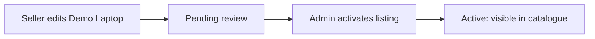
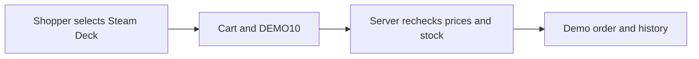

# Geek Lab project map

Geek Lab is a three-role ASP.NET Core MVC shop. Razor renders the pages, jQuery handles selected requests such as cart updates and Admin status changes, and EF Core writes to SQL Server. The demo sends account verification and recovery email to Mailpit.

The demo follows **two related but distinct examples**. A Demo Laptop moves through listing review; a Steam Deck is used to demonstrate checkout. They should not be presented as one uninterrupted purchase.

### Listing lifecycle

### Purchase lifecycle

These diagrams describe the supported walkthrough, not every state transition or every legacy route.

## Follow the code

| Workflow | Browser entry point | Start reading here |
| --- | --- | --- |
| Role sign-in and request pipeline | `/Admin/Login`, `/Seller/Login`, `/User/Login` | [Program.cs](../Program.cs) configures role cookies, redirects and response headers. The role controllers check session state. |
| Seller listing and inventory | `/Seller/ManageProducts` | [ManageProducts.cshtml](../Views/Seller/ManageProducts.cshtml) renders stock and listing status. [SellerController.cs](../Controllers/SellerController.cs) handles ownership, edits and uploads. |
| Admin product review | `/Admin/Index` | [Index.cshtml](../Views/Admin/Index.cshtml) renders the full listing and applies the filters. [AdminController.cs](../Controllers/AdminController.cs) supplies the list and persists status changes. |
| Shopper catalogue and cart | `/User/Products`, `/User/Cart` | [Products.cshtml](../Views/User/Products.cshtml) renders in-stock listings. [shop-catalogue.js](../wwwroot/js/shop-catalogue.js) handles search and cart feedback. [UserController.cs](../Controllers/UserController.cs) checks stock on cart updates. |
| Checkout and order history | `/User/Checkout`, `/User/TransactionHistory` | Follow `ProcessPayment` and `CompleteCheckout` in [UserController.cs](../Controllers/UserController.cs). [CheckoutPricing.cs](../Common/Pricing/CheckoutPricing.cs) owns pricing calculations. [AppDbContext.cs](../Data/AppDbContext.cs) maps the order and inventory records. |
| Account recovery | `/User/ForgotPassword`, `/Seller/ForgotPassword` | The role controllers issue and verify codes using [AccountVerificationCode.cs](../Common/Security/AccountVerificationCode.cs). The private demo delivers mail to Mailpit. |
| Regression evidence | `dotnet test Eduvo.Tests/Eduvo.Tests.csproj` | [MVC integration tests](../Eduvo.Tests/IntegrationSmokeTests.cs) exercise HTTP requests against the in-memory provider. [Verification notes](VERIFICATION.md) record the separate SQL Server runs. |

## Where the project can grow

The bigger idea is to follow what happens to a listing across roles and show people the information they need at each step. The current walkthrough follows the Demo Laptop from a Seller edit through Admin activation and catalogue visibility. It uses the Steam Deck to demonstrate the separate purchase and order-history steps. Three directions build on that story:

- **Seller visibility.** Show when a listing last changed status and why it was held back. A future version could keep a status history and surface stock approaching zero.
- **Admin accountability.** Record who changed a listing, when they changed it, and the reason. This would give the Seller a useful answer and give Admin a history to review.
- **Shopper clarity.** Explain stock or price changes before placing an order. Show the order outcome and the saved amount in one place.

Those are possible extensions. This portfolio documents the behaviour verified today and the [remaining hardening work](VERIFICATION.md#remaining-work).
